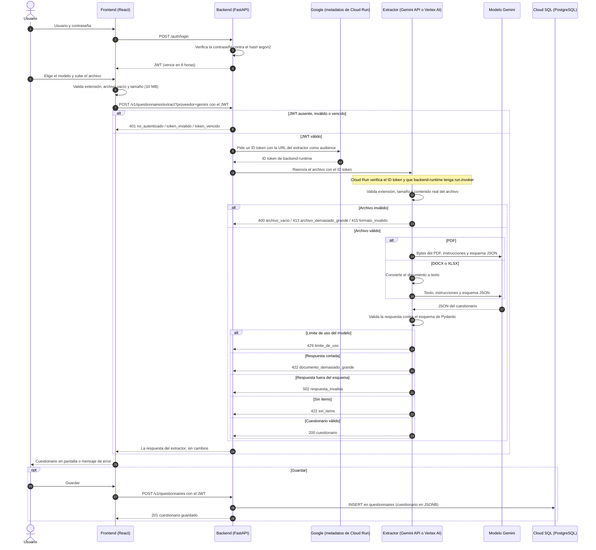
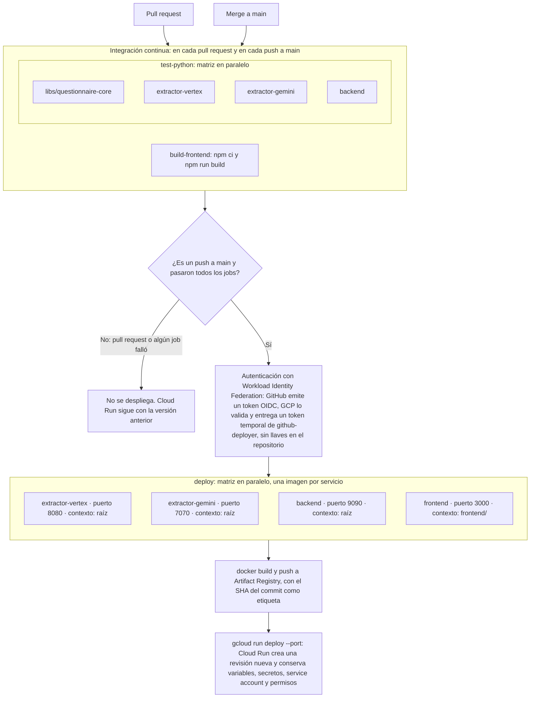

# psychometrics

Giunti Psychometrics está llevando sus cuestionarios y pruebas de evaluación en papel a su plataforma digital de administración y corrección. Hoy ese material existe en PDF, Word o Excel, y cargarlo a mano toma horas.

**psychometrics** es una aplicación web que recibe un cuestionario en PDF, Word (`.docx`) o Excel (`.xlsx`) y devuelve automáticamente sus ítems, tipos, alternativas y respuestas correctas en un JSON estandarizado.

## Aplicación desplegada

| | URL |
|---|---|
| **Aplicación** | https://frontend-189573939448.us-central1.run.app |
| API del backend (Swagger) | https://backend-189573939448.us-central1.run.app/docs |

La aplicación requiere iniciar sesión. **El usuario y la contraseña se envían por correo junto con la entrega**; no están en el repositorio.

Flujo de uso:

1. Iniciar sesión.
2. Elegir el modelo (**Gemini API** o **Vertex AI**) y el tipo de extracción (**un cuestionario**, o **todas las hojas** de un Excel).
3. Subir el archivo y pulsar **Extraer cuestionario**. Tarda entre 5 y 30 segundos.
4. Ver el cuestionario en pantalla, **descargar el JSON** o **guardarlo**.
5. En **Cuestionarios guardados**: verlos en un modal, descargarlos o eliminarlos.

Para probar hay archivos listos en [`examples/`](examples/).

> Cómo se construyó la interfaz: [diseño solo con CSS](doc/21-frontend-advanced.md#diseño-solo-con-css), [manejo de errores en la UI](doc/21-frontend-advanced.md#manejo-de-errores-en-la-ui) y [modal de cuestionarios guardados](doc/21-frontend-advanced.md#diseño-solo-con-css) ([video 9](https://youtu.be/HHIYMdQgaWQ), [video 10](https://www.youtube.com/watch?v=7phXoXy2F5g)).

## Formato de salida

```json
{
  "titulo": "Questionario di esempio",
  "idioma": "it",
  "total_items": 3,
  "items": [
    {
      "numero": 1,
      "enunciado": "Mi preoccupo eccessivamente per cose di poca importanza.",
      "tipo": "escala_likert",
      "alternativas": [{ "valor": 0, "texto": "Mai" }, { "valor": 1, "texto": "A volte" }],
      "respuesta_correcta": null
    }
  ]
}
```

Tipos de ítem: `escala_likert`, `seleccion_multiple`, `verdadero_falso`, `desarrollo` y `emparejamiento`.

Los errores se devuelven siempre con el mismo formato, y la interfaz los muestra al usuario:

```json
{ "error": "formato_invalido", "detalle": "El formato '.doc' no está soportado. Formatos válidos: .pdf, .docx, .xlsx." }
```

| HTTP | `error`                      | Cuándo                                                    |
|------|------------------------------|-----------------------------------------------------------|
| 400  | `archivo_vacio`              | El archivo no tiene contenido                             |
| 401  | `no_autenticado`, `token_vencido`, `credenciales_invalidas` | Falta iniciar sesión o la sesión venció |
| 413  | `archivo_demasiado_grande`   | Supera 10 MB                                              |
| 415  | `formato_invalido`           | Extensión no soportada o contenido que no coincide con ella |
| 422  | `sin_items`                  | No se detectaron ítems en el documento                    |
| 429  | `limite_de_uso`              | Se alcanzó el límite de uso del modelo                    |
| 502  | `respuesta_invalida`, `error_modelo`, `extractor_no_disponible` | Falló el modelo o un servicio interno |
| 504  | `tiempo_agotado`             | El procesamiento tardó demasiado                          |

> Detalle: [modelos de entrada y salida](doc/4-extractor-vertex.md#parte-1-modelos-de-entrada-y-salida), [salida estructurada del modelo](doc/4-extractor-vertex.md#salida-estructurada), [validación del archivo](doc/4-extractor-vertex.md#validación-del-archivo-appdocument_validationpy) y [errores de la UI](doc/21-frontend-advanced.md#manejo-de-errores-en-la-ui) ([video 3](https://youtu.be/eZNttZoc7JQ)).

## Arquitectura

```
navegador ──▶ frontend (React) ──▶ backend (FastAPI) ──┬──▶ extractor-gemini (FastAPI) ──▶ Gemini API
                                         │             └──▶ extractor-vertex (FastAPI) ──▶ Vertex AI
                                         ▼
                                Cloud SQL (PostgreSQL)
```

| Servicio           | Puerto | Qué hace |
|--------------------|--------|----------|
| `frontend`         | 3000   | Interfaz en React (Vite), solo con CSS propio. |
| `backend`          | 9090   | Inicio de sesión (JWT), consumo de los extractores y cuestionarios guardados en PostgreSQL. |
| `extractor-gemini` | 7070   | Extracción con la Gemini API (AI Studio). |
| `extractor-vertex` | 8080   | Extracción con Gemini en Vertex AI. |
| `libs/questionnaire-core` | — | Librería compartida por los extractores: modelos, validación, lectura de archivos, prompt y API. |

- **Monorepo en GCP:** cada servicio corre en **Cloud Run**, con despliegue automático desde GitHub Actions en cada merge a `main`.
- **Extractores privados:** solo el backend puede invocarlos, con un token de identidad de Google. Desde internet responden `403`.
- **Una sola llamada al modelo por documento**, con salida estructurada: el modelo responde con el esquema JSON generado desde los modelos de Pydantic, y la respuesta se vuelve a validar.
- **PDF** se envía directo al modelo, que así ve marcas, colores y tablas; **`.docx` y `.xlsx`** se convierten a texto antes.

> Detalle de cada decisión:
> - [Aplicación nativa de nube: misma imagen en local y en Cloud Run](doc/2-aplicacion-nativa.md#lo-que-se-ha-hecho) y [CI/CD con Workload Identity Federation](doc/2-aplicacion-nativa.md#paso-4-workload-identity-federation) ([video 1](https://youtu.be/JHTu_3EpiO4), [video 2](https://youtu.be/sdRRXk8aNe4)).
> - [Una sola llamada al modelo por documento](doc/4-extractor-vertex.md#decisión-general-una-sola-llamada-al-modelo) y [por qué el PDF va directo al modelo](doc/4-extractor-vertex.md#parte-5-pdf) ([video 3](https://youtu.be/eZNttZoc7JQ), [video 4](https://youtu.be/JrWypm4buGY)).
> - [Librería compartida y por qué es local y no un paquete desde GitHub](doc/14-extractor-gemini.md#por-qué-una-librería-local-y-no-un-paquete-desde-github) ([video 6](https://youtu.be/qP7xNOG01CU)).
> - [Extractores privados: solo el backend los invoca](doc/16-backend.md#plan-que-solo-el-backend-consuma-los-extractores) ([video 7](https://youtu.be/XE60ctTc6mQ)).
> - [PostgreSQL en Cloud SQL en lugar de Firestore](doc/16-backend.md#decisión-postgresql-en-lugar-de-firestore) y [capas de DDD](doc/16-backend.md#código-capas-de-ddd) ([video 8](https://youtu.be/SLykm3qkLLs)).

### Flujo de una extracción

Desde el inicio de sesión hasta que el cuestionario aparece en pantalla, con los posibles errores de cada paso:



## Correr localmente

Requisitos: Docker y Docker Compose. Todo corre en contenedores, incluido PostgreSQL.

```bash
# 1. Variables locales
cp .env.example .env
#    Completar GCP_PROJECT_ID, GEMINI_API_KEY y el usuario del backend.
#    El hash de la contraseña y la clave de los tokens se generan con:
python3 -m venv .venv && .venv/bin/pip install argon2-cffi
.venv/bin/python backend/scripts/hash_password.py

# 2. Credenciales de Vertex AI (solo para extractor-vertex), en un directorio aparte de gcloud
CLOUDSDK_CONFIG=~/.config/gcloud-psychometrics gcloud auth application-default login

# 3. Levantar todo
docker compose up --build                                                   # como en producción
docker compose -f docker-compose.yml -f docker-compose.dev.yml up --build   # desarrollo, con recarga en caliente
```

| Servicio           | URL local                  |
|--------------------|----------------------------|
| `frontend`         | http://localhost:3000      |
| `backend`          | http://localhost:9090/docs |
| `extractor-gemini` | http://localhost:7070/docs |
| `extractor-vertex` | http://localhost:8080/docs |

El backend aplica las migraciones de la base de datos (Alembic) al arrancar.

### Variables de entorno

Las variables locales están en [`.env.example`](.env.example). Detalle de cada servicio:

| Servicio | Variables principales | Detalle |
|---|---|---|
| `frontend` | `BACKEND_URL`, `PORT` | [frontend/README.md](frontend/README.md) |
| `backend` | `AUTH_USERNAME`, `AUTH_PASSWORD_HASH`, `JWT_SECRET`, `EXTRACTOR_GEMINI_URL`, `EXTRACTOR_VERTEX_URL`, `EXTRACTOR_AUTH`, `DB_*`, `CORS_ORIGINS` | [backend/README.md](backend/README.md) |
| `extractor-gemini` | `GEMINI_API_KEY`, `GENAI_MODEL`, `MAX_FILE_SIZE_MB`, `MAX_SHEETS` | [extractor-gemini/README.md](extractor-gemini/README.md) |
| `extractor-vertex` | `GOOGLE_CLOUD_PROJECT`, `GOOGLE_CLOUD_LOCATION`, `GENAI_MODEL`, `MAX_FILE_SIZE_MB`, `MAX_SHEETS` | [extractor-vertex/README.md](extractor-vertex/README.md) |

Las claves nunca van en el repositorio: en local salen de `.env` (ignorado por git) y en Cloud Run, de **Secret Manager**.

> Detalle: [credenciales de Vertex AI aisladas de otras cuentas](doc/4-extractor-vertex.md#credenciales-de-vertex-ai-local-y-cloud-run), [Docker Compose en dos modos](doc/2-aplicacion-nativa.md#docker-compose-en-dos-modos) y [generar las credenciales del backend](doc/16-backend.md#generar-las-credenciales).

## Despliegue continuo

Cada merge a `main` prueba y despliega los 4 servicios en Cloud Run. Detalle en [doc/2-aplicacion-nativa.md](doc/2-aplicacion-nativa.md#paso-5-tests-y-pipeline-de-github-actions).



## Tests

Más de 110 tests con Pytest. Ninguno llama a un modelo real ni necesita credenciales: los modelos y los extractores se simulan.

```bash
python3 -m venv .venv
.venv/bin/pip install -e "libs/questionnaire-core[dev]" -r backend/requirements.txt \
  -r extractor-vertex/requirements.txt -r extractor-gemini/requirements.txt

source .venv/bin/activate
for package in libs/questionnaire-core extractor-vertex extractor-gemini backend; do
  (cd $package && pytest -q)
done
```

- **Validación del archivo:** extensión, archivo vacío, tamaño máximo y contenido real que no coincide con la extensión.
- **Esquema de salida:** el ejemplo del enunciado, los nombres en español, los tipos de ítem, el idioma y cada resultado de `examples/`.
- **Extracción:** una sola llamada al modelo, respuestas cortadas, vacías o fuera del esquema, errores del proveedor y procesamiento de hojas de Excel en paralelo.
- **Backend:** inicio de sesión y tokens, consumo de los extractores, cuestionarios guardados y migraciones.

El CI corre todos los tests en cada pull request.

> Detalle de los tests de cada etapa: [extractor](doc/4-extractor-vertex.md#tests-teststest_questionnaire_extractorpy), [librería y servicios](doc/14-extractor-gemini.md#tests), [inicio de sesión](doc/16-backend.md#paso-2-inicio-de-sesión-de-un-solo-usuario) y [cuestionarios guardados](doc/16-backend.md#código-capas-de-ddd).

## Ejemplos

[`examples/`](examples/) tiene tres cuestionarios inventados, cada uno con el JSON que devolvió cada proveedor:

| Caso | Archivo | Contenido |
|---|---|---|
| `01-tipo-doc` | `.docx` | Likert, selección múltiple con respuesta correcta y desarrollo |
| `02-tipo-xlsx` | `.xlsx` con 3 hojas (español, italiano e inglés) | Los 5 tipos de ítem |
| `03-tipo-pdf` | `.pdf` de 3 páginas | Los 5 tipos, respuestas marcadas con `(X)` y clave de respuestas en la última página |

Gemini API y Vertex AI dieron resultados idénticos en los tres casos.

> Resultados de cada caso: [`02-tipo-xlsx`](doc/4-extractor-vertex.md#caso-de-prueba-02-tipo-xlsx), [`03-tipo-pdf`](doc/4-extractor-vertex.md#caso-de-prueba-03-tipo-pdf) y [comparación entre Gemini API y Vertex AI](doc/14-extractor-gemini.md#comparación-con-vertex-ai) ([video 4](https://youtu.be/JrWypm4buGY), [video 6](https://youtu.be/qP7xNOG01CU)).

## Supuestos

- **Escala Likert:** si el documento no indica los valores, se numeran desde 0 en el orden en que aparecen las opciones (0–3 para 4 puntos, 0–4 para 5 puntos), como en el ejemplo del enunciado.
- **Selección múltiple:** `valor` es la letra de la opción (A, B, C...). Si las opciones no tienen letra, se asignan en orden.
- **Verdadero/falso:** las alternativas son `V` y `F`, con el texto en el idioma del documento.
- **Emparejamiento:** el conjunto de pares es **un solo ítem**, con la instrucción como enunciado. Las alternativas son la columna izquierda (`1`, `2`, `3`...) y la derecha (`a`, `b`, `c`...), y la respuesta correcta es un texto con los pares: `"1-b; 2-c; 3-a"`.
- **Respuesta correcta:** se incluye solo si el documento la indica (marcada, resaltada o en una clave de respuestas). El modelo nunca resuelve los ítems por su cuenta.
- **Idioma:** se detecta el idioma en que está escrito el documento, como código ISO 639-1. No se limita a italiano, español e inglés.
- **Título:** es `null` si el documento no tiene título.
- **Excel:** la extracción normal lee **solo la primera hoja**, porque devuelve un cuestionario por archivo. Para procesar todas las hojas, cada una como un cuestionario, está la opción **Todas las hojas del Excel** (`/extract-sheets`).
- **`.doc` antiguo:** no se soporta; los formatos son `.pdf`, `.docx` y `.xlsx`, como pide el enunciado.
- **Tamaño máximo:** 10 MB por archivo.
- **Usuario:** la aplicación tiene **un solo usuario**, configurado por variables de entorno, sin registro.
- **Filtros de seguridad del modelo:** desactivados, porque los cuestionarios psicológicos tratan temas sensibles (ansiedad, autolesiones) y los filtros podrían bloquear ítems legítimos.

> Cómo se llegó a estas reglas: [instrucciones del modelo](doc/4-extractor-vertex.md#instrucciones-del-sistema), [regla de emparejamiento y por qué cambió](doc/4-extractor-vertex.md#regla-de-emparejamiento), [solo la primera hoja del Excel y el endpoint por hojas](doc/4-extractor-vertex.md#parte-4-excel-y-emparejamiento), [filtros de seguridad](doc/4-extractor-vertex.md#filtros-de-seguridad) y [usuario único sin base de datos](doc/16-backend.md#sin-base-de-datos) ([video 4](https://youtu.be/JrWypm4buGY)).

## Además de lo pedido

| Extra | Qué aporta | Detalle |
|---|---|---|
| **Dos proveedores de LLM** | Gemini API y Vertex AI con el mismo código; sus resultados se compararon con los mismos ejemplos y fueron idénticos | [doc 14](doc/14-extractor-gemini.md#comparación-con-vertex-ai) |
| **Librería compartida** (`questionnaire-core`) | Modelos, validación, lectura de archivos, prompt y API se escriben una sola vez; cada extractor es solo configuración y cliente | [doc 14](doc/14-extractor-gemini.md#librería-questionnaire-core) |
| **Todas las hojas de un Excel en paralelo** | Un endpoint especializado procesa cada hoja como un cuestionario, con errores aislados por hoja | [doc 4](doc/4-extractor-vertex.md#parte-4-excel-y-emparejamiento) |
| **Inicio de sesión** | JWT, contraseña con hash argon2, el mismo error para usuario o contraseña incorrectos y tiempo de respuesta constante | [doc 16](doc/16-backend.md#paso-2-inicio-de-sesión-de-un-solo-usuario) |
| **Cuestionarios guardados** | PostgreSQL en Cloud SQL, con capas de DDD (dominio, casos de uso, repositorio, API) y migraciones con Alembic | [doc 16](doc/16-backend.md#paso-4-base-de-datos-en-cloud-sql) |
| **Extractores privados** | Solo el backend los invoca, con un token de identidad de Google; desde internet responden `403`. Nadie puede consumir el modelo sin iniciar sesión | [doc 16](doc/16-backend.md#plan-que-solo-el-backend-consuma-los-extractores) |
| **Secretos fuera del código** | Workload Identity Federation para el CI/CD y Secret Manager para las claves: no hay llaves ni contraseñas en el repositorio | [doc 2](doc/2-aplicacion-nativa.md#paso-4-workload-identity-federation), [doc 14](doc/14-extractor-gemini.md#configuración-en-gcp) |
| **Permisos mínimos** | Una service account por servicio, con solo los permisos que usa | [doc 4](doc/4-extractor-vertex.md#configuración-en-gcp), [doc 16](doc/16-backend.md#permisos-de-backend-runtime) |
| **CI/CD** | GitHub Actions: tests en cada pull request y despliegue de los 4 servicios en cada merge a `main` | [doc 2](doc/2-aplicacion-nativa.md#paso-5-tests-y-pipeline-de-github-actions) |
| **Aplicación nativa de nube** | La misma imagen corre en local con Docker Compose y en Cloud Run; modo desarrollo con recarga en caliente | [doc 2](doc/2-aplicacion-nativa.md#lo-que-se-ha-hecho) |
| **Interfaz completa** | Diseño propio solo con CSS, indicadores de carga, errores visibles, validación del archivo antes de subirlo y modal de cuestionarios guardados | [doc 21](doc/21-frontend-advanced.md) |
| **Trazabilidad** | Una rama por etapa, documentación de cada decisión y de los problemas encontrados, y videos de avance | [Documentación y videos](#documentación-y-videos) |

## Limitaciones conocidas

- **Sobreingeniería deliberada.** Para un MVP, cinco servicios, identidad entre servicios, DDD y migraciones son más de lo necesario: la extracción en sí es simple y está aislada en la librería compartida. Se hizo así a propósito, para mostrar cómo se diseñaría la solución en un entorno real (seguridad, despliegue continuo, persistencia y separación de responsabilidades). Una versión mínima sería un solo servicio con el extractor y el frontend.
- **Las migraciones corren al arrancar el contenedor** del backend (`alembic upgrade head` antes de `uvicorn`). Con una o pocas instancias funciona bien: si ya están aplicadas, no hace nada. Con muchas instancias arrancando a la vez podrían competir por aplicarlas; lo correcto sería ejecutarlas como un paso aparte del despliegue, por ejemplo un Cloud Run Job.
- **Los tests del backend usan SQLite en memoria**, no PostgreSQL. Se decidió así por tiempo: son rápidos y no necesitan servidor, y el modelo usa JSON genérico fuera de PostgreSQL y JSONB en PostgreSQL. La verificación contra PostgreSQL 17 real (migración, guardar, listar, ver, eliminar y tipos de columna) se hizo a mano en un contenedor, no en el CI. Lo correcto sería que el CI levantara un PostgreSQL en Docker y corriera los tests contra él.

## Documentación y videos

El proyecto se construyó por etapas, cada una en su rama. Cada etapa tiene su documento, con las decisiones tomadas, los problemas encontrados y cómo se resolvieron, y un video de avance.

| # | Etapa | Documento | Secciones clave | Videos |
|---|---|---|---|---|
| 1 | Lectura de la prueba y planeación | [1-lectura-y-planeacion](doc/1-lectura-y-planeacion.md) | Lectura, decisiones y orden de trabajo | [video 1](https://youtu.be/JHTu_3EpiO4) |
| 2 | Aplicación nativa de nube | [2-aplicacion-nativa](doc/2-aplicacion-nativa.md) | [Docker Compose en dos modos](doc/2-aplicacion-nativa.md#docker-compose-en-dos-modos), [Cloud Run](doc/2-aplicacion-nativa.md#paso-3-primer-despliegue-manual-en-cloud-run), [Workload Identity Federation](doc/2-aplicacion-nativa.md#paso-4-workload-identity-federation), [pipeline de CI/CD](doc/2-aplicacion-nativa.md#paso-5-tests-y-pipeline-de-github-actions) | [video 1](https://youtu.be/JHTu_3EpiO4), [video 2](https://youtu.be/sdRRXk8aNe4) |
| 4 | Extractor con Vertex AI | [4-extractor-vertex](doc/4-extractor-vertex.md) | [Modelos](doc/4-extractor-vertex.md#parte-1-modelos-de-entrada-y-salida), [extractor](doc/4-extractor-vertex.md#parte-2-extractor-con-vertex-ai), [endpoint y validación](doc/4-extractor-vertex.md#parte-3-endpoint-y-validación-de-entrada), [Excel y emparejamiento](doc/4-extractor-vertex.md#parte-4-excel-y-emparejamiento), [PDF](doc/4-extractor-vertex.md#parte-5-pdf) | [video 3](https://youtu.be/eZNttZoc7JQ), [video 4](https://youtu.be/JrWypm4buGY) |
| 11 | Primer frontend | [11-frontend-essentials](doc/11-frontend-essentials.md) | Subir el archivo y ver la respuesta, puertos por servicio | [video 5](https://youtu.be/Xh-uiG-vrBg) |
| 14 | Librería compartida y extractor con la Gemini API | [14-extractor-gemini](doc/14-extractor-gemini.md) | [Librería `questionnaire-core`](doc/14-extractor-gemini.md#librería-questionnaire-core), [configuración en GCP](doc/14-extractor-gemini.md#configuración-en-gcp), [comparación con Vertex AI](doc/14-extractor-gemini.md#comparación-con-vertex-ai) | [video 6](https://youtu.be/qP7xNOG01CU) |
| 16 | Backend y base de datos | [16-backend](doc/16-backend.md) | [Inicio de sesión](doc/16-backend.md#paso-2-inicio-de-sesión-de-un-solo-usuario), [consumo de los extractores](doc/16-backend.md#paso-3-el-backend-consume-los-extractores), [Cloud SQL](doc/16-backend.md#paso-4-base-de-datos-en-cloud-sql), [extractores privados](doc/16-backend.md#plan-que-solo-el-backend-consuma-los-extractores), [frontend en crudo](doc/16-backend.md#paso-6-el-frontend-usa-el-backend) | [video 7](https://youtu.be/XE60ctTc6mQ), [video 8](https://youtu.be/SLykm3qkLLs) |
| 21 | Frontend final | [21-frontend-advanced](doc/21-frontend-advanced.md) | [Funciones](doc/21-frontend-advanced.md#funciones), [diseño solo con CSS](doc/21-frontend-advanced.md#diseño-solo-con-css), [manejo de errores en la UI](doc/21-frontend-advanced.md#manejo-de-errores-en-la-ui) | [video 9](https://youtu.be/HHIYMdQgaWQ), [video 10](https://www.youtube.com/watch?v=7phXoXy2F5g) |

Listado completo de los videos, con lo que muestra cada uno: [doc/videos.md](doc/videos.md).
