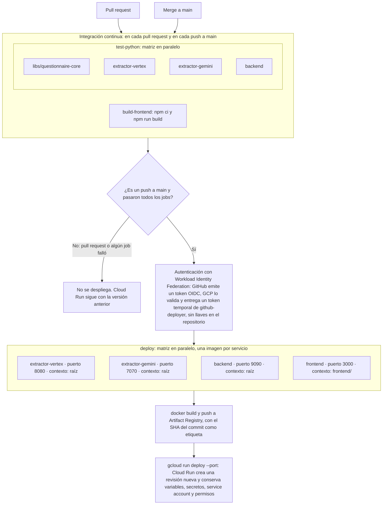

# 2 - Aplicación nativa

Lo ideal sería empezar ya con las reglas de negocio, pero antes prefiero dejar listo el entorno para que la aplicación sea nativa de nube. Muchas ideas que funcionan en local se encuentran con limitaciones al momento de desplegar.

Por eso el entorno debe funcionar igual en local y en la nube desde los primeros commits, y a partir de ahí se avanza con cambios pequeños.

## Alcance de esta etapa

- Un hola mundo en `extractor-vertex` (FastAPI).
- Un hola mundo en `frontend` (React).
- Dockerizar ambos servicios.
- Levantarlos juntos con Docker Compose y conectarlos de forma simple: el frontend llama al extractor y muestra la respuesta.
- Crear la cuenta y el proyecto en GCP.
- Desplegar ambos servicios en Cloud Run.
- Un pipeline en GitHub que ejecute los tests y despliegue en Cloud Run.
- Tests básicos con Pytest para el extractor.

Fuera de alcance: la extracción de cuestionarios, Vertex AI, el backend y la base de datos.

## Puntos a cuidar entre local y cloud

- **Puerto:** Cloud Run indica el puerto en la variable `PORT`, así que no se deja fijo en el código.
- **URL del extractor en el frontend:** en local se usa la de Docker Compose y en cloud la pública de Cloud Run. Se configura por variable de entorno.
- **CORS:** el extractor debe permitir el origen del frontend en ambos entornos.
- **Acceso público:** los servicios se despliegan con acceso sin autenticación para que la app sea accesible.
- **Credenciales del pipeline:** GitHub Actions se autentica en GCP sin guardar llaves en el repositorio.
- **Imágenes:** se publican en Artifact Registry, en la misma región que Cloud Run.

## Lo que se ha hecho

### Servicios dockerizados

- **extractor-vertex:** FastAPI con `GET /` y `GET /health`, sobre `python:3.12-slim`. Escucha en `$PORT` (8080 por defecto).
- **frontend:** React con Vite. La imagen tiene dos etapas: una compila con `npm run build` y otra sirve los archivos con `serve` en `$PORT`. No se usa nginx porque Cloud Run ya se encarga del tráfico HTTP.

### Comunicación entre servicios

- La llamada al extractor la hace el navegador, no el contenedor. Por eso la URL es la pública: `localhost:8080` en local y la de Cloud Run en la nube.
- **Configuración en tiempo de ejecución:** al arrancar, el frontend genera `config.js` con la variable `EXTRACTOR_VERTEX_URL`. Así la misma imagen sirve para cualquier entorno, sin recompilar.
- **CORS:** el extractor solo permite los orígenes definidos en `CORS_ORIGINS`.

### Docker Compose en dos modos

- **Producción** (`docker-compose.yml`): construye las mismas imágenes que irán a Cloud Run. Sirve para validar antes de cada push.
- **Desarrollo** (`docker-compose.dev.yml`, encima del anterior): monta el código como volumen, con `uvicorn --reload` en el extractor y el servidor de Vite en el frontend, para tener recarga en caliente. En este modo Vite sirve `config.js` igual que en producción.

### Variables de entorno

| Servicio           | Variable               | Local                   | Cloud Run                     |
|--------------------|------------------------|-------------------------|-------------------------------|
| `extractor-vertex` | `CORS_ORIGINS`         | `http://localhost:3000` | URL de Cloud Run del frontend |
| `frontend`         | `EXTRACTOR_VERTEX_URL` | `http://localhost:8080` | URL de Cloud Run del extractor |
| ambos              | `PORT`                 | `8080`                  | La asigna Cloud Run           |

## Integración con GCP y GitHub

Se hace en una cuenta personal de GCP, por pasos:

1. **Cuenta y proyecto:** cuenta de GCP, facturación, alerta de presupuesto y una configuración de `gcloud` aparte.
2. **APIs y Artifact Registry:** habilitar los servicios de Google necesarios y crear el repositorio de imágenes Docker.
3. **Primer despliegue manual en Cloud Run:** subir los dos servicios y conectarlos con sus URLs.
4. **Workload Identity Federation:** permitir que GitHub se autentique en GCP sin guardar llaves en el repositorio.
5. **GitHub Actions:** tests, build y despliegue automático en cada push.

**Costos:** Cloud Run con `min-instances=0` y Artifact Registry prácticamente entran en la capa gratuita con este tráfico. Lo que tendrá costo más adelante es Vertex AI.

**Región:** `us-central1`, porque tiene Vertex AI y Cloud Run y es de las más económicas.

### Paso 1: cuenta y proyecto

**En la consola** (https://console.cloud.google.com):

1. Activar la facturación.
2. En **Billing → Budgets & alerts**, crear un presupuesto de USD 10 con alertas al 50%, 90% y 100%.

**En la terminal**, usar una configuración de `gcloud` separada para no mezclar este proyecto con otras cuentas:

```bash
# Solo la terminal actual usa esta configuración
export CLOUDSDK_ACTIVE_CONFIG_NAME=psychometrics
gcloud config configurations create psychometrics

gcloud auth login

# Verificar antes de seguir: debe mostrar la cuenta personal
gcloud config list

# El ID del proyecto debe ser único en todo GCP
gcloud projects create psychometrics-brahi --name="psychometrics"
gcloud config set project psychometrics-brahi
gcloud config set run/region us-central1

# Vincular la facturación (usar la cuenta con OPEN = True)
gcloud billing accounts list
gcloud billing projects link psychometrics-brahi --billing-account=<ID_DE_LA_CUENTA>

# Verificar que el proyecto existe
gcloud projects list
```

En cada terminal nueva hay que repetir el `export CLOUDSDK_ACTIVE_CONFIG_NAME=psychometrics`. No se usa `gcloud config configurations activate` porque cambia la configuración en todas las terminales.

**Problemas encontrados:**

- **El proyecto no aparecía en la consola.** El `gcloud auth login` se ejecutó en una terminal sin el `export`, así que la cuenta quedó en la configuración `default` y `psychometrics` quedó sin cuenta. Por eso `gcloud projects create` falló. Se corrigió asignando la cuenta a cada configuración y volviendo a crear el proyecto:

  ```bash
  gcloud config set account <cuenta-personal> --configuration=psychometrics
  ```

- **En la consola web** hay que revisar que la sesión sea la de la cuenta personal y buscar el proyecto en la pestaña **All** del selector de proyectos, no en **Recent**.

### Paso 2: APIs y Artifact Registry

```bash
# APIs necesarias: Cloud Run, Artifact Registry e IAM (para que GitHub se autentique después)
gcloud services enable \
  run.googleapis.com \
  artifactregistry.googleapis.com \
  iam.googleapis.com \
  iamcredentials.googleapis.com \
  sts.googleapis.com

# Repositorio de imágenes Docker
gcloud artifacts repositories create psychometrics \
  --repository-format=docker \
  --location=us-central1 \
  --description="Imágenes de los servicios de psychometrics"


# Permitir que docker suba imágenes a Artifact Registry
gcloud auth configure-docker us-central1-docker.pkg.dev
```

Las imágenes quedan en:

```
us-central1-docker.pkg.dev/psychometrics-brahi/psychometrics/extractor-vertex
us-central1-docker.pkg.dev/psychometrics-brahi/psychometrics/frontend
```

La API de Vertex AI (`aiplatform.googleapis.com`) se habilita en la etapa del extractor.

### Paso 3: primer despliegue manual en Cloud Run

Hay una dependencia circular: el frontend necesita la URL del extractor y el extractor necesita la URL del frontend para el CORS. Se resuelve desplegando primero el extractor, luego el frontend, y al final actualizando el CORS del extractor.

```bash
REG=us-central1-docker.pkg.dev/psychometrics-brahi/psychometrics

# 1. extractor-vertex
docker build --platform linux/amd64 -t $REG/extractor-vertex:v1 ./extractor-vertex
docker push $REG/extractor-vertex:v1

gcloud run deploy extractor-vertex \
  --image=$REG/extractor-vertex:v1 \
  --allow-unauthenticated \
  --min-instances=0 --max-instances=2

EV_URL=$(gcloud run services describe extractor-vertex --format="value(status.url)")

# 2. frontend, apuntando al extractor
docker build --platform linux/amd64 -t $REG/frontend:v1 ./frontend
docker push $REG/frontend:v1

gcloud run deploy frontend \
  --image=$REG/frontend:v1 \
  --allow-unauthenticated \
  --min-instances=0 --max-instances=2 \
  --set-env-vars=EXTRACTOR_VERTEX_URL=$EV_URL

FE_URL=$(gcloud run services describe frontend --format="value(status.url)")

# 3. CORS en el extractor, con la URL del frontend
gcloud run services update extractor-vertex --update-env-vars=CORS_ORIGINS=$FE_URL
```

- **`--platform linux/amd64`:** la imagen corre en Cloud Run sin importar la arquitectura de la máquina donde se construye.
- **`--min-instances=0`:** sin tráfico no hay costo, a cambio de un arranque en frío de 1 a 3 segundos.
- **`--max-instances=2`:** límite de escalado como protección de costos.
- **URLs fijas:** las URLs de Cloud Run no cambian entre despliegues, así que el paso 3 se hace una sola vez.

Resultado:

| Servicio           | URL                                               |
|--------------------|---------------------------------------------------|
| `frontend`         | https://frontend-yu7lpen3ba-uc.a.run.app          |
| `extractor-vertex` | https://extractor-vertex-yu7lpen3ba-uc.a.run.app  |

Se verificó que el frontend carga la URL del extractor desde `config.js`, que el extractor responde y que el CORS solo permite el origen del frontend.

Las variables de la terminal (`REG`, `EV_URL`, `FE_URL`) solo existen en la sesión actual. Lo que persiste son las variables de entorno guardadas en cada servicio de Cloud Run, que se pueden consultar con:

```bash
gcloud run services describe frontend --format="value(spec.template.spec.containers[0].env)"
```

#### Problema: cada servicio tiene dos URLs

Después del despliegue, el frontend mostraba *"No se pudo conectar con extractor-vertex"* al abrirse desde la URL que aparece en la consola de GCP.

**Causa:** Cloud Run asigna dos URLs a cada servicio y `CORS_ORIGINS` solo tenía una:

| Formato  | Ejemplo                                                | Cómo se forma                                              |
|----------|--------------------------------------------------------|------------------------------------------------------------|
| Antiguo  | `https://frontend-<hash>-uc.a.run.app`                 | Hash generado por Google y código abreviado de la región. No se conoce antes del primer despliegue. |
| Nuevo    | `https://frontend-<PROJECT_NUMBER>.us-central1.run.app` | Nombre del servicio, número de proyecto y región. Se puede calcular antes de desplegar. |

Google introdujo el formato nuevo (*deterministic URLs*) para que la URL sea predecible, y mantiene el antiguo por compatibilidad. `status.url` sigue devolviendo el antiguo, mientras que la consola muestra el nuevo. Por eso el CORS se configuró con una URL y la app se abrió desde la otra.

**Las URLs no cambian entre despliegues.** Cada despliegue crea una revisión nueva, pero ambas URLs se mantienen mientras exista el servicio. Solo cambian si el servicio se recrea con otro nombre, en otra región o en otro proyecto.

**Solución:** permitir las dos URLs en `CORS_ORIGINS`, una sola vez:

```bash
gcloud run services update extractor-vertex \
  --update-env-vars="^@^CORS_ORIGINS=https://frontend-<hash>-uc.a.run.app,https://frontend-<PROJECT_NUMBER>.us-central1.run.app"
```

El prefijo `^@^` cambia el separador de variables de `gcloud` a `@`, para que la coma quede dentro del valor.

Para consultar las dos URLs de un servicio:

```bash
gcloud run services describe frontend --format="value(metadata.annotations['run.googleapis.com/urls'])"
```

**Decisión:** se usa el formato nuevo como URL oficial, en el README y en las variables de entorno, porque es predecible. El antiguo se sigue permitiendo en el CORS porque cualquiera puede abrir la app por esa URL.

### Paso 4: Workload Identity Federation

GitHub Actions obtiene un token temporal de GCP solo para este repositorio, sin guardar llaves JSON.

```bash
PROJECT_ID=psychometrics-brahi
PROJECT_NUMBER=$(gcloud projects describe $PROJECT_ID --format="value(projectNumber)")
GH_REPO=mathbrahian/psychometrics
SA=github-deployer@$PROJECT_ID.iam.gserviceaccount.com

# 1. Service account con la que despliega GitHub
gcloud iam service-accounts create github-deployer --display-name="GitHub Actions deployer"

for role in roles/run.admin roles/artifactregistry.writer roles/iam.serviceAccountUser; do
  gcloud projects add-iam-policy-binding $PROJECT_ID \
    --member="serviceAccount:$SA" --role=$role --condition=None
done

# 2. Pool y proveedor OIDC de GitHub, restringido al repositorio
gcloud iam workload-identity-pools create github \
  --location=global --display-name="GitHub"

gcloud iam workload-identity-pools providers create-oidc github-provider \
  --location=global --workload-identity-pool=github \
  --display-name="GitHub provider" \
  --issuer-uri="https://token.actions.githubusercontent.com" \
  --attribute-mapping="google.subject=assertion.sub,attribute.repository=assertion.repository" \
  --attribute-condition="assertion.repository=='$GH_REPO'"

# 3. Permitir que solo este repositorio use la service account
gcloud iam service-accounts add-iam-policy-binding $SA \
  --role=roles/iam.workloadIdentityUser \
  --member="principalSet://iam.googleapis.com/projects/$PROJECT_NUMBER/locations/global/workloadIdentityPools/github/attribute.repository/$GH_REPO"
```

| Permiso                         | Para qué                                                     |
|---------------------------------|--------------------------------------------------------------|
| `roles/run.admin`               | Desplegar servicios en Cloud Run.                            |
| `roles/artifactregistry.writer` | Subir imágenes a Artifact Registry.                          |
| `roles/iam.serviceAccountUser`  | Desplegar con la identidad que usan los servicios en ejecución. |

El `--attribute-condition` garantiza que solo los tokens emitidos para `mathbrahian/psychometrics` sean aceptados.

Variables en GitHub (Settings → Secrets and variables → Actions → **Variables**). No son secretas, pero aquí se muestran con valores de ejemplo:

| Variable              | Valor de ejemplo                                                                               |
|-----------------------|------------------------------------------------------------------------------------------------|
| `GCP_PROJECT_ID`      | `mi-proyecto-123`                                                                              |
| `GCP_REGION`          | `us-central1`                                                                                  |
| `GCP_WIF_PROVIDER`    | `projects/000000000000/locations/global/workloadIdentityPools/github/providers/github-provider` |
| `GCP_SERVICE_ACCOUNT` | `github-deployer@mi-proyecto-123.iam.gserviceaccount.com`                                      |

Se pueden crear desde la terminal con `gh`:

```bash
gh variable set GCP_PROJECT_ID -R <usuario>/<repo> --body "mi-proyecto-123"
gh variable set GCP_REGION -R <usuario>/<repo> --body "us-central1"
gh variable set GCP_WIF_PROVIDER -R <usuario>/<repo> --body "projects/000000000000/locations/global/workloadIdentityPools/github/providers/github-provider"
gh variable set GCP_SERVICE_ACCOUNT -R <usuario>/<repo> --body "github-deployer@mi-proyecto-123.iam.gserviceaccount.com"
```

El número de proyecto se obtiene con `gcloud projects describe <PROJECT_ID> --format="value(projectNumber)"`.

### Paso 5: tests y pipeline de GitHub Actions

**Estado final del pipeline**, después de sumar la librería compartida, `extractor-gemini` y el backend (etapas 14 y 16):



El resto de esta sección describe la primera versión, con `extractor-vertex` y el frontend.

**Tests** (`extractor-vertex/tests/`), con Pytest y el `TestClient` de FastAPI:

- `GET /` y `GET /health` responden lo esperado.
- El CORS permite el origen configurado y rechaza los demás.

Las dependencias de test van en `requirements-dev.txt`, separadas de las de producción, y la carpeta `tests/` no entra en la imagen Docker.

**Workflow** (`.github/workflows/ci-cd.yml`):

| Job                     | Cuándo corre             | Qué hace                                              |
|-------------------------|--------------------------|-------------------------------------------------------|
| `test-extractor-vertex` | Cada PR y push a `main`  | Instala dependencias y corre `pytest`.                |
| `build-frontend`        | Cada PR y push a `main`  | Verifica que el frontend compila.                     |
| `deploy`                | Solo push a `main`       | Si los dos anteriores pasan, construye, sube la imagen y despliega cada servicio. |

- **Flujo de ramas:** en cada PR corren los tests, y al mergear a `main` se despliega.
- **Autenticación:** con Workload Identity Federation (`google-github-actions/auth`), usando las variables del paso 4. No hay llaves en el repositorio.
- **Imágenes:** se etiquetan con el SHA del commit, así cada versión en Cloud Run se puede rastrear hasta su commit.
- **Despliegue en paralelo:** `extractor-vertex` y `frontend` se despliegan a la vez con una matriz.
- **Variables de entorno:** `gcloud run deploy` conserva las variables ya guardadas en cada servicio (`CORS_ORIGINS`, `EXTRACTOR_VERTEX_URL`), así que el workflow no necesita conocer las URLs.

Correr los tests en local:

```bash
cd extractor-vertex
pip install -r requirements.txt -r requirements-dev.txt
pytest -v
```

## Resultado esperado

Con un `docker compose up` la aplicación funciona en local, y con un push a GitHub queda desplegada en Cloud Run con la misma configuración.
